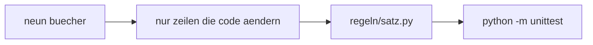
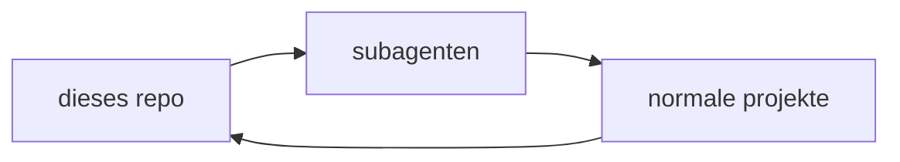

# code anleitung

kurze regeln zum coden. aus neun büchern nur die zeilen, die im code etwas ändern.
die bücher selbst liegen nicht hier.

## problem

ein langes regelwerk wird nicht benutzt. hier steht nur, was `regeln/satz.py` festhält und `python -m unittest` prüft.

## ablauf

1. die neun bücher lesen
2. nur die zeilen behalten, die eine codezeile ändern
3. diese zeilen in `regeln/satz.py`
4. das beispiel `regeln/rechnung.py` hält sich daran
5. `python -m unittest` fängt namen, kommentare, geschluckte fehler, nackte zahlen, verbotene imports und import-kreise



## start

```powershell
python -m unittest
python -m regeln.pruefen
```

grün heisst: der code in diesem repo hält die regeln.

## von hier

subagenten gehen von diesem repo in die normalen projekte und erledigen dort die aufgabe.
beobachtet wird von hier. der lauf und das ergebnis bleiben hier sichtbar.



cursor in einem anderen projekt:

```powershell
.\INSTALL.ps1 -TargetProject "D:\Pfad\dein-projekt"
```

linux und macos: `./INSTALL.sh /pfad/dein-projekt`.
details: [INSTALL.md](INSTALL.md).

## was man sieht

öffentlich: die kurzen regeln, die prüfung, das beispiel, die zusammenfassungen.
privat: die buch-pdfs. die stehen nicht im repo und nicht unter dieser lizenz.

pro buch die zeilen, die im code sind: `1/im_code.md` bis `9/im_code.md`.
die lange zusammenfassung daneben bleibt zum nachlesen.

## lizenz

MIT. forken, ändern und ein review sind erlaubt. der text steht in [LICENSE](LICENSE).
wie man mitmacht: [CONTRIBUTING.md](CONTRIBUTING.md).
fremde werke: [NOTICE.md](NOTICE.md).
